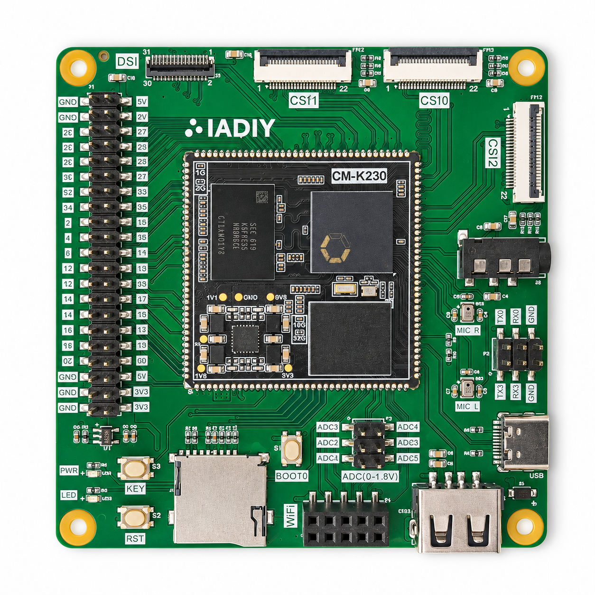

# IADIY K230 IMX335 USB Camera

IADIY release: **v0.1.00**.

This application turns the **CM-K230 Base Board with eMMC and an IMX335 camera** into a USB UVC camera, with optional LCD preview. The SDK can package either a Debian 13 or Ubuntu 24.04 runtime image with the IMX335 VVCAM configuration, FFmpeg, and the `k230-camera` application.

The application profile is `k230_canmv_iadiy_emmc_imx335_uvc_defconfig`. **Connect the IMX335 camera module to the board's CSI2 connector.** 
The module must be compatible with this connector; the driver uses I2C bus 0, address `0x1a`, a 24 MHz input clock, and two MIPI data lanes.

## Host Setup
A host machine run `Ubuntu 20.04`, `Ubuntu 22.04` and `Ubuntu 24.04` for cross compiling is required.

Install the host build packages:

```bash
sudo apt update
sudo apt install -y \
    git sed make binutils build-essential diffutils gcc g++ bash patch gzip \
    bzip2 perl tar cpio unzip rsync file bc findutils wget libncurses-dev \
    python3 python3-pip libssl-dev gawk cmake bison flex bash-completion \
    parted curl xz-utils
```

The SDK also needs the Python C preprocessor `pcpp` on Ubuntu 24.04:

```bash
sudo apt install -y python3-pcpp
```

Then run the SDK installer to install the remaining dependencies and the Xuantie toolchain under `/opt/toolchain`:

```bash
sudo make toolchain_and_depend
```

See the [installer](tools/install_toolchain_and_depend.sh) for the package list and toolchain download.

## Build the Application Image

```bash
make CONF=k230_canmv_iadiy_emmc_imx335_uvc_defconfig
make buildroot
```

`make CONF=...` selects the profile **and builds it**. The following `make buildroot` resumes or regenerates its base images. Selection is saved in `.last_conf` for subsequent commands. Run selection and compilation as your normal user; distribution image generation requires root. Select this profile explicitly on a fresh checkout; the SDK's fallback configuration is unchanged.

Then choose the operating system to run on the K230 and run its packaging command:

Debian 13:
```bash
sudo make debian
```

Ubuntu 24.04:
```bash
sudo make ubuntu
```

Both commands require the selected profile's existing `sysimage-sdcard.img`. They package built artifacts without compiling changed components. See the [incremental build guide](docs/project-guide.md#incremental-build-commands) before rebuilding individual components; its examples use Debian packaging, so use `sudo make ubuntu` when packaging Ubuntu.

Existing users of the previous IMX335 profile must select the new name above. Build artifacts use a new output directory; existing build directories are not migrated automatically.

## Hardware Setup



With board power off, connect a compatible IMX335 camera module to **CSI2**. If using LCD preview, connect the compatible LCD to **DSI** before powering on.

Use these separate connections:

- **USB device port (Type-C):** Use a data-capable Type-C cable for flashing image , and to the viewing host for UVC camera operation.
- **Serial console (TX0/RX0/GND header):** connect a USB-to-UART(TTL) adapter to the header marked **TX0**, **RX0**, and **GND**. Connect board TX0 to adapter RX, board RX0 to adapter TX, and GND to GND. Use an adapter with logic levels compatible with the board's UART; verify compatibility before connecting.

Power the board separately rather than through the adapter's power pin.

The serial console uses the header, not the Type-C USB device port.

## Flash the eMMC Image

The selected distribution's image is under:

```text
output/k230_canmv_iadiy_emmc_imx335_uvc_defconfig/images/
```

Flash `debian.img.gz` for Debian or `ubuntu.img.gz` for Ubuntu. The same directory contains a versioned `*_debian_*.img.gz` or `*_ubuntu_*.img.gz` symlink for each packaged distribution, base `sysimage-sdcard.img` artifacts, kernel and device trees, and DEB packages under `deb/`.

Use the Windows Kendryte K230BurningTool over USB:

1. With the board powered off, connect its Type-C USB device port to the Windows PC using a data-capable cable.
2. Hold **BOOT** (marked **BOOT0** on this carrier board) while powering on to enter USB burning mode.
3. On first use, download Zadig and K230BurningTool. Confirm the K230 USB device appears in Windows Device Manager, select that device in Zadig, and install its driver. Confirm Device Manager no longer shows a warning icon for it.
4. Open K230BurningTool, select `debian.img.gz` or `ubuntu.img.gz` from the directory above, and flash **eMMC**. Wait for the tool to report completion.
5. Power-cycle the board with BOOT released to boot the installed system normally.

See the [flashing guide](docs/project-guide.md#flash-the-emmc-board) for one-time Windows driver setup and detailed steps.

## System Login

Connect the USB-to-UART adapter wired to **TX0/RX0/GND** to your computer. Identify the adapter's serial port in Windows Device Manager under **Ports (COM & LPT)**, or on Linux by checking the kernel messages after connecting it (for example, with `dmesg`) or listing `/dev/serial/by-id/` when available. The COM number or Linux device name depends on the adapter and computer.

Open that serial port in Teraterm or another serial terminal with **115200 baud, 8 data bits, no parity, 1 stop bit, and no flow control**. Open the terminal before the normal power-on to observe boot messages. Wait for the login prompt, then log in to either the K230 Debian or Ubuntu system with these credentials:

- Account: `root`
- Password: `root`

## Run the USB Camera

Keep the serial console connected and connect the board's Type-C USB device port to the viewing host with a data-capable cable. The camera application starts manually. Run as root from the serial console or a network session with `vvcam.service` active and `/dev/video1` available. Stop other camera, UVC, and display applications first. USB camera mode replaces USB ADB/MTP and can disconnect a USB shell.

```bash
k230-camera           # USB camera with LCD preview
k230-camera --no-lcd  # USB camera only
```

On the USB host, select the camera in a UVC-compatible viewer. The default stream is MJPEG at 2592×1944 with a nominal 30 fps; the host can also select 640×360, 1280×720, or 1920×1080. Actual throughput depends on scene complexity and host behavior. The optional LCD preview uses an 800×480 output.

Press Ctrl+C to stop the application and restore previously active ADB/MTP. Logs are under `/run/k230-camera/`. See the [camera guide](docs/project-guide.md#manual-imx335-usb-camera) for operation details and validation notes.

The UVC gadget uses test VID `0x1209` and PID `0x0001`; replace these IDs before production use.

## Further Documentation

- [Project guide](docs/project-guide.md): hardware assumptions, incremental builds, and camera details.
- [Linux SDK README](docs/README.md): broader SDK documentation and other board configurations.
